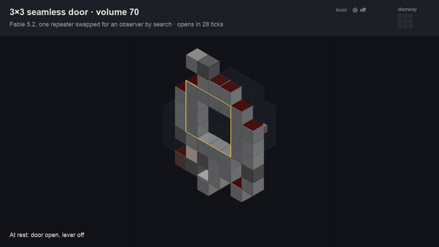
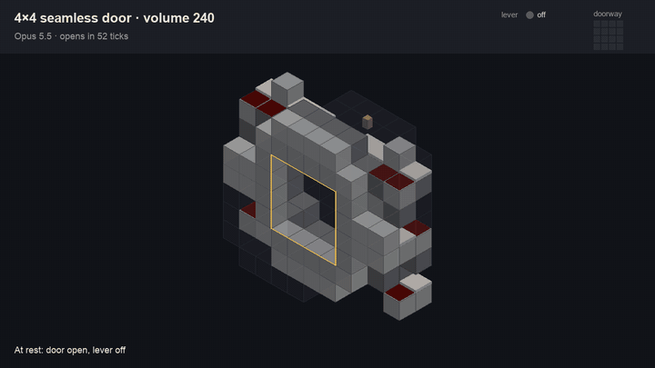
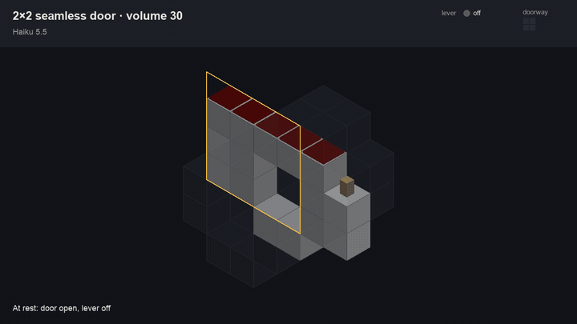
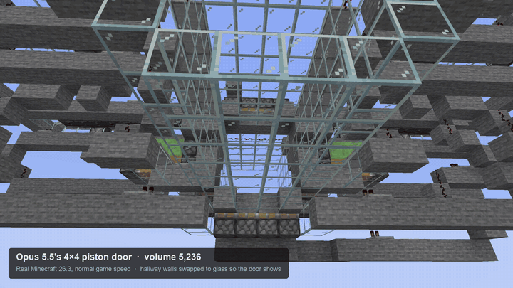
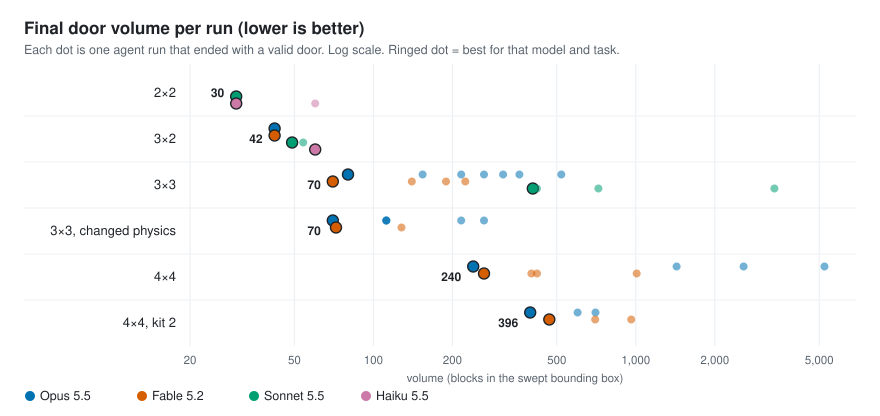

# mc-evals

**Piston Door Bench.** Frontier LLM agents design flush Minecraft piston doors in the smallest box they can. The game engine itself grades every design.

<p align="center">
  
</p>

<p align="center">
  
  
</p>

## The task

An agent gets a size (2×2 up to 5×5), a rulebook and a set of tools. It has a time limit to build a **seamless** piston door: when open, the doorway is clear and flush with the wall, and when closed, it is solid stone. Lower volume wins. Volume is the bounding box of every cell the mechanism ever occupies, moving pistons included.

The agent can test parts in a lab world and step the simulation tick by tick. It then submits a design, which the grader judges:

- **Real engine.** A headless, unmodified Minecraft Java **26.3** server, stepped one game tick at a time.
- **Strict.** The final grade runs 8 open/close cycles with staggered timing. It fails the design if any block drops as an item, any piston pushes into the hallway, or any wall cell changes. It also re-checks the door at 11 shifted positions and turned 180°.
- **Changed physics.** A Java agent can patch game constants, such as repeater step 3 ticks or observer delay 3 ticks. This tests whether a model reasons about the mechanism or recalls community designs.

<p align="center">
  
  <br><sub>An agent's 4×4 door, loaded into the real Minecraft 26.3 client at normal game speed. The hallway is glass so the door is visible.</sub>
</p>

## Results

64 finished agent runs across 4 models and 7 task setups. 54 of them ended with a valid door.

<p align="center"></p>

| Task | Smallest door | Model |
|---|---:|---|
| 2×2 seamless | 30 | Haiku 5.5, Sonnet 5.5 |
| 3×2 seamless | 42 | Opus 5.5, Fable 5.2 |
| 3×3 seamless | 70 | Fable 5.2 |
| 3×3, changed physics | 70 | Opus 5.5 |
| 4×4 seamless | 240 | Opus 5.5 |

- **Spread within a model is larger than spread between models.** Opus's 3×3 doors range from 80 to 729 across 10 runs. Which run you look at matters more than which model.
- **Changed physics did not hurt.** Opus's median 3×3 is 126 under changed timings (9 runs) against 288 under standard rules (10 runs). An earlier gap (p = 0.05 over waves 1–8) did not replicate in a 50-minute wave 9 (pooled p = 0.23), so the claim is "no worse", not "better". Either way, Opus isn't leaning on memorized community designs that the change would break. [Wave 9 write-up](runs/bench/w9/RESULTS.md).
- **Every block is load-bearing.** We graded all 12,376 one-block changes to the Fable 70 and the Opus 240. Removing any single block breaks the door, and no single change makes either door smaller. Shrinking them takes moves that change several blocks at once.
- **Search makes doors faster.** A greedy search over repeater, observer and comparator swaps found faster versions of 7 of the first 19 doors it checked, at the same volume. All 7 pass every robustness check. The Fable 70 goes from 34/22 ticks (open/close) to **28/16**.

Full write-ups: [results](reports/Piston%20Door%20Bench%20results.md), [single-edit census](runs/bench/search_pilot/CENSUS.md), [search and EDA research](reports/Piston%20door%20design%20search.md).

## Grade a design

```bash
cd grader
python3 -m pdgrader setup --java-home <jdk-25-home> --server-jar <server.jar>
python3 -m pdgrader grade fixtures/good_2x2.json --n 2 --track seamless
python3 -m pdgrader grade my_door.json --n 3 --track seamless --final --translations
```

A design is plain JSON: an initial state, plus a list of blocks with positions relative to the doorway.

```json
{"initial_state": "open",
 "blocks": [{"pos": [-1, 0, 0], "id": "sticky_piston", "props": {"facing": "east"}}, ...]}
```

## Layout

| Path | What it holds |
|---|---|
| `grader/` | `pdgrader` (rules, validation, grading, agent kits, run server) and `kernel/` (the Java harness that steps the server, plus the physics-patching agent) |
| `runs/bench/w1` … `w9` | One folder per agent run: server log, final design and grade |
| `runs/bench/search_pilot/` | Single-edit census and speed search |
| `runs/bench/tasks/` | 95 verified repair and physics-port tasks: doors, logic circuits and piston machines |
| `runs/bench/video/` | Renderer, door films and the real-client recording setup |
| `reports/`, `research_notes/` | Write-ups and the notes behind them |

The Minecraft server and client jars, the JDK and raw captures are not in the repo; scripts fetch them.

<sub>This history was rebuilt from file timestamps after the work was done. Each file is committed at the time it was last changed.</sub>
